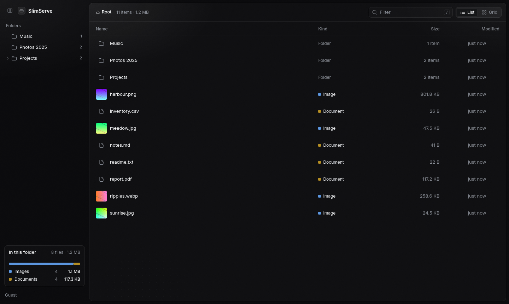
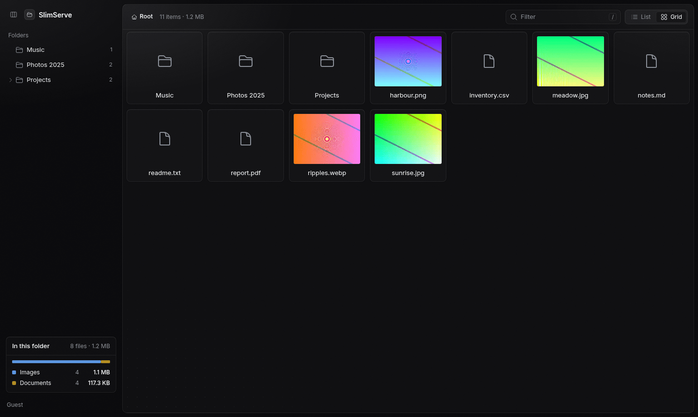
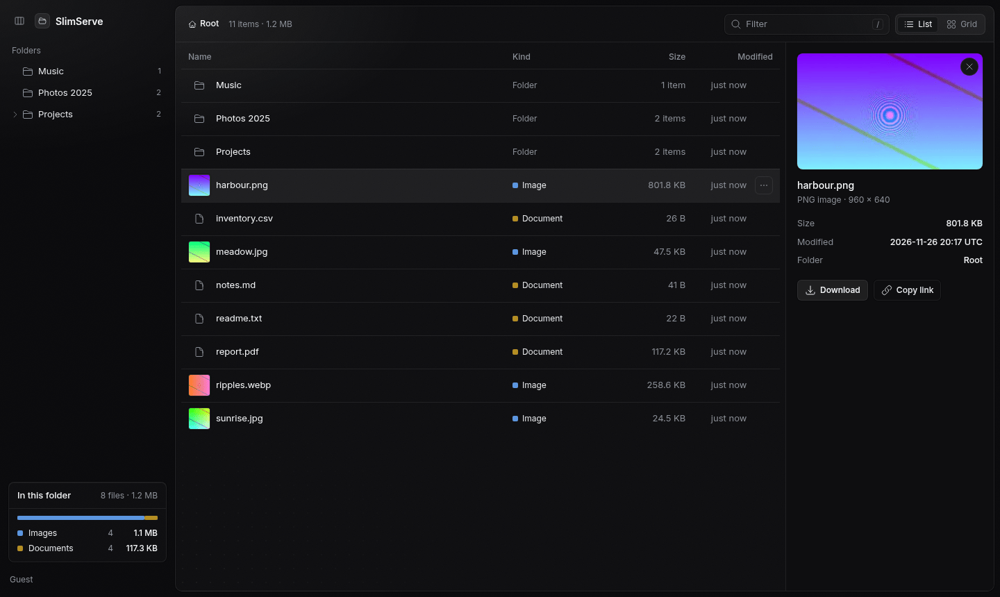

# SlimServe

SlimServe serves a folder, or an S3 bucket, as a file browser in the web page. Folders list as a
table or a grid of thumbnails, and the listing updates by itself when files change. Click a file to
see its details; follow a link to download it. A login can guard the whole site, and a separate
write password lets you upload, rename, move and delete from the browser.







Hidden files (any name starting with a dot) are never listed or served. A `.slimserveignore` file
hides more, with gitignore-style patterns, in its folder and everything below it.

## Quickstart

The image is `ghcr.io/xeome/slimserve`. It listens on port 8080 and serves `/data`:

```sh
docker run -d --name slimserve -p 8080:8080 -v /srv/files:/data:ro ghcr.io/xeome/slimserve:1.0.0
```

Then open http://localhost:8080. The container runs as UID and GID 1001, so the files must be
readable by that user, and writable too if you turn on browser edits.

With Docker Compose, and a login:

```yaml
services:
  slimserve:
    image: ghcr.io/xeome/slimserve:1.0.0
    ports:
      - "8080:8080"
    volumes:
      - /srv/files:/data
    environment:
      SLIMSERVE_USERNAME: alice
      SLIMSERVE_PASSWORD: change-me
      SLIMSERVE_WRITE_PASSWORD: change-me-too
      SECRET_KEY_BASE: paste-the-output-of-openssl-rand-base64-48
    restart: unless-stopped
```

For Kubernetes, see the [Helm chart](manifests/helm/README.md).

The server speaks plain HTTP. On the internet, put it behind a proxy that terminates TLS, and set
`SLIMSERVE_HTTPS=true` and `PHX_HOST` to the hostname clients use. Do that behind any TLS proxy,
even on a LAN.

## Configuration

Everything is set through environment variables.

| Variable | Default | What it does |
| --- | --- | --- |
| `SLIMSERVE_ROOT` | `.` (`/data` in the image) | The folder served at `/`. A release refuses to start unless it names an existing directory. |
| `PORT` | `4000` (`8080` in the image) | The HTTP port. |
| `PHX_HOST` | `localhost` | The hostname clients use, for the URLs the app builds. |
| `SLIMSERVE_HTTPS` | `false` | `true` redirects to HTTPS and marks cookies secure. Needs `PHX_HOST`. |
| `SECRET_KEY_BASE` | random per start | Signs the session cookie. Required with a login. |
| `SLIMSERVE_USERNAME`, `SLIMSERVE_PASSWORD` | unset | Put every page behind a login. Set both or neither. |
| `SLIMSERVE_WRITE_PASSWORD` | unset | Turns on editing from the browser. Must differ from `SLIMSERVE_PASSWORD`. |
| `SLIMSERVE_UPLOAD_MAX_MB` | `100` | The largest upload. |
| `SLIMSERVE_UPLOAD_TYPES` | any | Comma-separated extensions to accept, such as `jpg,png,pdf`. |
| `SLIMSERVE_THUMB_MAX_DIM` | `250` | The longest side of a thumbnail, in pixels. |
| `SLIMSERVE_THUMB_MAX_FILE_SIZE_MB` | `10` | Images larger than this get no thumbnail. |
| `SLIMSERVE_THUMB_CACHE_MB`, `SLIMSERVE_CACHE_DIR` | `100`, the temp dir | The thumbnail cache on disk. |
| `SLIMSERVE_STORAGE` | `local` | `s3` serves a bucket instead of `SLIMSERVE_ROOT`. See below. |
| `SLIMSERVE_TRUSTED_PROXIES` | unset | Comma-separated addresses and CIDRs of proxies whose `X-Forwarded-For` names the client. See below. |

### Login

With `SLIMSERVE_USERNAME` and `SLIMSERVE_PASSWORD` set, every page asks for them. Setting only one
refuses to start. Changing the password logs everyone out.

Set a fixed `SECRET_KEY_BASE` whenever there is a login: `openssl rand -base64 48` makes one. The
server refuses to start with a login and without the key, because a fresh key on each start would
log everyone out.

### Editing from the browser

With `SLIMSERVE_WRITE_PASSWORD` set, whoever logs in with it at `/.app/login` can upload files,
create folders, and rename, move and delete from the listing. They can also open the Phoenix
dashboard at `/.app/dashboard`. With a viewer login on, the write login takes the same username.
Changing the write password ends every write session. Without a fixed `SECRET_KEY_BASE`, so does
each restart.

- Nothing is ever overwritten. An upload or a move onto an existing name is refused.
- There is no trash. Deleting a folder deletes everything in it, hidden files too.
- Uploads and file moves need a file system with hard links: ext4, xfs, btrfs or overlayfs work,
  exFAT and some SMB mounts do not.
- A crash during an upload can leave a hidden `.upload-*` file in the target folder. It is never
  served, and you can delete it.
- An extension in `SLIMSERVE_UPLOAD_TYPES` with no known MIME type refuses to start.

### Serving an S3 bucket

Set `SLIMSERVE_STORAGE=s3` to serve a private bucket of any S3-compatible store, MinIO included.

| Variable | Default | What it does |
| --- | --- | --- |
| `SLIMSERVE_S3_BUCKET` | required | The bucket. |
| `AWS_ACCESS_KEY_ID`, `AWS_SECRET_ACCESS_KEY` | required | The credentials. |
| `AWS_SESSION_TOKEN` | unset | For temporary credentials. |
| `AWS_REGION` | `us-east-1` | The region requests are signed for. |
| `AWS_ENDPOINT_URL_S3` | AWS | The store's URL. Requests are path-style, so it names the store, not the bucket. |
| `SLIMSERVE_DOWNLOAD_CACHE_MB` | `1024` | The download cache's size. |
| `SLIMSERVE_DOWNLOAD_CACHE_DIR` | the temp dir | Where the download cache lives. |

Files up to 100 MB are cached on disk once fetched, so a repeat download, ranged or not, reads
nothing from the bucket. Larger files, and files the cache has no room for, stream through.

AWS itself is untested. If you try it, set `AWS_ENDPOINT_URL_S3` to the bucket region's endpoint
(`https://s3.<region>.amazonaws.com`). Without it, requests go to the global host, and a bucket that
redirects to its regional host answers every request with a 502.

SlimServe must be the bucket's only writer. A change made through SlimServe shows at once, on every
node. A change made in the bucket directly can take up to 10 minutes to show.

If the store lets a write overwrite an existing key, uploads and new folders are off, with a warning
at start. A move or delete that fails part-way says so and leaves what it already did. The full
rules are in [openspec/specs/s3-storage/spec.md](openspec/specs/s3-storage/spec.md).

### Running several replicas

Several replicas can serve one S3 bucket behind a proxy or an Ingress. On local storage they can
serve one volume too, all on the node that holds it: the [Helm chart](manifests/helm/README.md#storage)
pins them there.

- Probe `GET /.app/healthz` for liveness and `GET /.app/readyz` for readiness. Both answer without
  login, and over plain HTTP with `SLIMSERVE_HTTPS=true`. Neither reaches the bucket.
- Set `SLIMSERVE_TRUSTED_PROXIES` to the proxies' own addresses or the proxy pods' CIDR, such as
  `10.42.7.0/28` or `10.0.0.5, 10.0.0.6`. Without it the login rate limit sees every client as the
  proxy. With it, the client is the right-most `X-Forwarded-For` address that is not a trusted
  proxy, so a client cannot forge its own. Never list a range that also holds clients: a client
  inside it counts as a proxy, so it can forge its address and dodge the limit. The limit spans
  every replica, a moment late.
- The replicas cluster on port 4370, with no epmd. Open 4370 between the pods only, never on the
  public Service. To cluster, set on every replica:
  - `RELEASE_DISTRIBUTION=name`.
  - `RELEASE_NODE=<one name>@<the replica's own IP>`, such as `slimserve@$(POD_IP)`. The replicas
    find each other by IP, so every replica needs the same name before the `@`.
  - `DNS_CLUSTER_QUERY` to a DNS name whose A records are the replicas' IPs, such as a headless
    Service.
  - `RELEASE_COOKIE` to a secret that every replica shares. Without it the release refuses to
    start, because anyone who pulls the image can read its built-in cookie.
- Unless `RELEASE_DISTRIBUTION` is `name` or `sname`, the release runs no Erlang distribution and
  takes no cluster connection. An empty value also means none. So `bin/slimserve remote`, `rpc`,
  `stop` and `pid` cannot reach it, because each one connects to the node. For a live shell on one
  container, start it with `-e RELEASE_DISTRIBUTION=sname -e RELEASE_COOKIE=<a secret>`, then run
  `docker exec -it <name> bin/slimserve remote`.
- On SIGTERM, `/.app/readyz` answers 503 for 5 seconds while the replica still takes requests.
  Then it stops accepting and lets every open download run to its end. An upload still in progress
  is cut, and the user sends it again. So give the pod a grace period that fits your longest
  download.

## Development

```sh
mise install                   # Erlang, Elixir, bun, actionlint and Helm, pinned in .tool-versions
sudo pacman -S inotify-tools   # or apt-get; the app does not start without inotifywait
mix setup                      # deps, the Tailwind and esbuild binaries, a first asset build
SLIMSERVE_ROOT=~/Pictures mix phx.server   # http://localhost:4000
```

Two gates:

- `mix precommit` runs in seconds: compile with warnings as errors, unused locked deps, formatting
  (Styler), Credo and the tests. Run it before every commit.
- `mix ci` is everything CI runs: the above plus `hex.audit`, Sobelow, `deps.audit`, Dialyzer, a
  coverage floor, and the OpenSpec validate, which runs on bun. The first Dialyzer run builds its
  PLTs in `priv/plts` and takes a few minutes.

CI also runs the chart suite (`mix test --only helm`, needs `helm`). The S3 suite runs only
locally, against a throwaway MinIO: `scripts/test-s3.sh mix test --only s3`. It needs Docker and a
cached or pullable MinIO image. CI cannot pull that image, so it skips the S3 suite.

What the app does, behaviour by behaviour, is in `openspec/specs/`. How a request flows is in
`docs/architecture.md`, and the project rules are in `AGENTS.md`.
